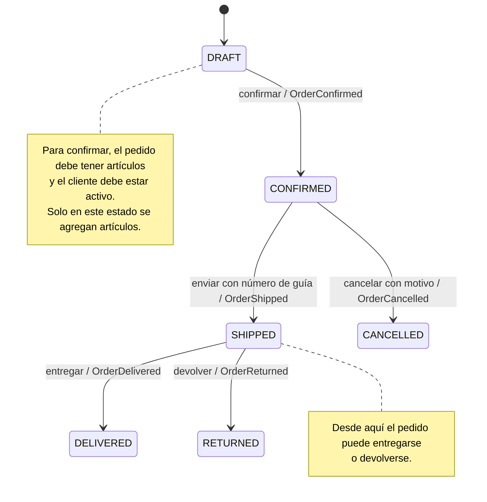

# TechStore U4

API para administrar pedidos de TechStore con FastAPI. Los pedidos se cargan
desde los archivos CSV de `datos/` y se mantienen en memoria mientras el
servidor está ejecutándose.

## Requisitos

- Python 3.11 o posterior
- pip

## Instalación en Windows

Abre PowerShell en la carpeta raíz del proyecto y ejecuta:

```powershell
py -m venv .venv
.\.venv\Scripts\Activate.ps1
python -m pip install fastapi uvicorn pytest httpx
```

Si PowerShell no permite activar el entorno virtual, puedes ejecutar los
comandos usando directamente su intérprete:

```powershell
.\.venv\Scripts\python.exe -m pip install fastapi uvicorn pytest httpx
```

## Cargar y revisar los datos

Los datos de clientes, productos, pedidos y detalles están en `datos/`.
`cargar_csv.py` los convierte a objetos del dominio:

```powershell
python cargar_csv.py
```

Los pedidos se vuelven a cargar automáticamente cuando inicia la aplicación.
Los cambios realizados a través de la API no se guardan en los CSV ni en una
base de datos; desaparecen al reiniciar el proceso.

## Ejecutar las pruebas

Desde la raíz del proyecto:

```powershell
python -m pytest -q
```

Las pruebas de dominio están en `tests/test_domain.py` y las pruebas HTTP en
`tests/test_api.py`.

## Ejecutar la API

Inicia Uvicorn desde la raíz del proyecto:

```powershell
python -m uvicorn app.api:app --reload
```

Mientras el servidor esté en ejecución:

- Swagger UI: <http://127.0.0.1:8000/docs>
- Contrato OpenAPI: <http://127.0.0.1:8000/openapi.json>

En Swagger UI, elige una operación, pulsa **Try it out**, proporciona los
parámetros o el cuerpo JSON y pulsa **Execute**.

## Reglas del dominio

- Un pedido nuevo comienza en `DRAFT`.
- Solo se confirma desde `DRAFT`, si tiene artículos y el cliente está activo.
- Se pueden agregar artículos solo en `DRAFT`; el máximo es 20 unidades por
  pedido.
- Los importes se representan con `Decimal`; `Money` no acepta importes
  negativos.
- El descuento VIP del 10 % requiere cliente VIP, total mayor que 500 MXN, al
  menos 4 unidades y ninguna promoción activa.
- El descuento del 5 % requiere un total mayor que 5000 MXN y ninguna
  promoción activa. Si aplican ambos descuentos, se elige primero el 10 %.
- Un pedido solo puede enviarse desde `CONFIRMED` y requiere un número de guía
  no vacío.
- Un pedido solo puede cancelarse desde `CONFIRMED` y requiere un motivo no
  vacío.
- Un pedido solo puede entregarse o devolverse desde `SHIPPED`.
- Las transiciones válidas registran un evento. Una operación rechazada no
  cambia el estado ni agrega su evento.

### Diagrama de estados del pedido



`DELIVERED`, `CANCELLED` y `RETURNED` son estados finales: el dominio no define
transiciones posteriores. Para confirmar se requieren artículos y un cliente
activo; para enviar se requiere un número de guía no vacío y para cancelar, un
motivo no vacío. Los artículos solo se pueden agregar en `DRAFT`.

### Domain events

Un *domain event* representa un hecho que ya ocurrió en el dominio. En esta
aplicación, cada transición válida de estado agrega un `DomainEvent` al pedido.
El evento contiene el nombre del hecho (`name`), el ID del pedido
(`order_id`) y la fecha y hora de creación en UTC (`occurred_at`).

| Evento | Hecho representado | Transición |
| --- | --- | --- |
| `OrderConfirmed` | El pedido quedó confirmado. | `DRAFT` → `CONFIRMED` |
| `OrderShipped` | El pedido fue enviado. | `CONFIRMED` → `SHIPPED` |
| `OrderCancelled` | El pedido fue cancelado. | `CONFIRMED` → `CANCELLED` |
| `OrderDelivered` | El pedido fue entregado. | `SHIPPED` → `DELIVERED` |
| `OrderReturned` | El pedido fue devuelto. | `SHIPPED` → `RETURNED` |

Los eventos se agregan únicamente después de validar y aplicar la transición.
Por ello, una transición rechazada no cambia el estado ni agrega un evento.
Agregar artículos o calcular descuentos tampoco genera eventos en la
implementación actual. La lista se mantiene en memoria y se incluye al
consultar un pedido; no se persiste en los CSV ni se publica a un sistema
externo.

## Endpoints

| Método | Ruta | Descripción |
| --- | --- | --- |
| `GET` | `/orders/{order_id}` | Obtiene los datos de un pedido, sus artículos y eventos. |
| `POST` | `/orders/{order_id}/confirm` | Confirma un pedido. |
| `POST` | `/orders/{order_id}/ship` | Envía un pedido confirmado. |
| `POST` | `/orders/{order_id}/cancel` | Cancela un pedido confirmado. |

Las rutas de envío y cancelación reciben estos cuerpos JSON:

```json
{
  "tracking_number": "TRACK-001"
}
```

```json
{
  "reason": "Solicitud del cliente"
}
```

### Respuestas de error

- `404 Not Found`: el ID del pedido no existe.
- `409 Conflict`: el estado actual no permite la transición solicitada.
- `422 Unprocessable Entity`: los datos enviados o los datos del pedido no
  cumplen las reglas del dominio.
